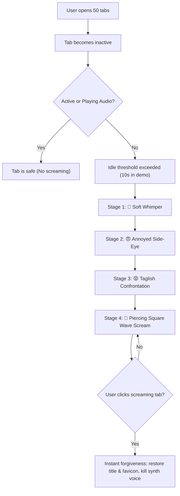

<p align="center">
  
</p>

<h1 align="center">Micro-Screamer</h1>

<p align="center">
  <b>Built for Codex DevDay Mini Hackathon 🚀</b><br>
  Enterprise-grade tab accountability and productivity compliance.<br>
  When you ignore your browser tabs, they guilt-trip you like abandoned pets and scream in synthetic chorus.
</p>

<p align="center">
  <a href="https://developer.chrome.com/docs/extensions/mv3/"></a>
  <a href="https://developer.mozilla.org/en-US/docs/Web/API/Web_Audio_API"></a>
  <a href="https://developer.chrome.com/docs/extensions/reference/api/offscreen"></a>
  <a href="https://developer.mozilla.org/en-US/docs/Web/JavaScript"></a>
  <a href="#"></a>
</p>

<p align="center">
  
  
  
  
  
</p>

<p align="center">
  <a href="#about">About</a> ·
  <a href="#rage-stages">Rage Stages</a> ·
  <a href="#tech-stack">Tech Stack</a> ·
  <a href="#quick-start">Quick Start</a> ·
  <a href="#how-it-works">How It Works</a> ·
  <a href="#project-layout">Project Layout</a> ·
  <a href="#safety-and-compliance">Compliance</a> ·
  <a href="#faq">FAQ</a>
</p>

---

## About

**Micro-Screamer** is a deadpan, enterprise-grade tab accountability Chrome extension built for the **Codex DevDay Mini Hackathon**.

Are you a chronic tab hoarder with 50+ open tabs you will never read? Micro-Screamer makes your neglected tabs impossible to ignore. Left inactive past the idle limit (10 minutes normally, or 10 seconds in Demo mode), neglected tabs turn into guilt-tripping, screaming entities:

- Their favicons hijack into escalating meme / emoji rage faces.
- Their titles transform into urgent Taglish guilt-trips (*"bakit mo ako iniwan?"*, *"NAKA-SEEN LANG AKO??"*, *"WALA NA FINISH NA"*).
- An offscreen Web Audio synthesizer generates distinct wobbly, microtonal screams for every single neglected tab.
- The longer you ignore them, the louder, harsher, and higher-pitched the cacophony becomes.
- Clicking any neglected tab immediately grants forgiveness: the audio stops and the original title and favicon are restored.

---

## Rage Stages

| Stage | Duration (Demo Mode) | Face & Favicon | Sample Title Line | Synth Audio Characteristics |
| :-- | :-- | :-- | :-- | :-- |
| **Stage 1: The Whimper** | 0 – 10s idle | 🥺 Crying | *"bakit mo ako iniwan?"* | Soft, wobbly sine wave with gentle vibrato |
| **Stage 2: The Side-Eye** | 10 – 20s idle | 😠 Side-Eye | *"NAKA-SEEN LANG AKO??"* | Nasal triangle wave with rapid tremolo pulse |
| **Stage 3: The Confrontation** | 20 – 30s idle | 😡 Furious | *"GRABE KA TALAGA"* | Harsh sawtooth wave, higher pitch & volume |
| **Stage 4: The Meltdown** | 30s+ idle | 🤬 Meltdown | *"WALA NA FINISH NA"* | Piercing square wave at peak resonance |

---

## Tech Stack

### Core Technologies

| Category | Technology | Purpose |
| :-- | :-- | :-- |
| **Platform** | [Chrome Extensions MV3](https://developer.chrome.com/docs/extensions/mv3/) | Service workers, permission handling, declarative manifest |
| **Background Service** | Chrome Service Worker (`background.js`) | Periodic idle monitoring, tab state machines, badge counting |
| **DOM Manipulation** | Content Scripts (`content.js`) | Dynamic SVG emoji & favicon injection, title backup & restoration |
| **Sound Synthesis** | [Web Audio API](https://developer.mozilla.org/en-US/docs/Web/API/Web_Audio_API) + Chrome Offscreen | Zero-asset oscillators, frequency modulation vibrato, tremolo LFOs |
| **UI** | HTML5 / CSS3 / Vanilla JavaScript | Deadpan corporate compliance popup UI & landing page |
| **Event / Hackathon** | **Codex DevDay Mini Hackathon** | Hackathon project track |

---

## Quick Start

### Installation

1. **Clone the repository:**
   ```bash
   git clone https://github.com/helenaherrero515/smthfunny.git
   cd smthfunny
   ```
2. **Open Extensions in Chrome:**
   Navigate to `chrome://extensions` in your address bar.
3. **Enable Developer Mode:**
   Toggle on **Developer mode** in the top-right corner.
4. **Load the Extension:**
   Click **Load unpacked** and select this directory (`smthfunny`).
5. **Pin & Trigger Demo Mode:**
   - Click the extension icon in your toolbar.
   - Check **"Demo mode (10 seconds)"**.
   - Open 5+ new tabs (Wikipedia, Google, GitHub, etc.).
   - Switch away to a different tab and wait 10 seconds.
   - Watch the favicons twist into angry memes and hear the choir of screaming tabs begin!

---

## How It Works



1. **Tab Telemetry:** `background.js` samples inactive tabs every 3 seconds. Tabs currently active or playing media are automatically exempt.
2. **In-Tab Hijack:** `content.js` caches `document.title` and existing `<link rel="icon">`, replacing them with escalating SVG data URIs and Taglish call-outs.
3. **Offscreen Web Audio:** Manifest V3 service workers cannot play audio directly. Micro-Screamer dynamically manages a Chrome `offscreen.html` document with oscillator nodes, tremolos, and vibrato generators mapped uniquely per tab ID to create cacophony.

---

## Project Layout

```text
smthfunny/
├── assets/
│   └── logo/
│       └── logo.png          # Micro-Screamer angry mascot logo
├── face-cry.jpg              # Stage 1 Whimper meme face
├── face-sideye.jpg           # Stage 2 Side-Eye meme face
├── face-rage.jpg             # Stage 3 & 4 Rage meme face
├── manifest.json             # Chrome Extension Manifest V3 configuration
├── background.js             # Background Service Worker tab monitor & state tracker
├── content.js                # In-page title & favicon injector + restorer
├── offscreen.html            # Web Audio API multi-voice synthesizer engine
├── popup.html                # Corporate toolbar popup with demo & mute toggles
├── index.html                # Interactive landing page & showcase
└── README.md                 # Product documentation
```

---

## Safety & Compliance

- **Zero External Telemetry:** All tab idle tracking is 100% local inside the browser. No servers, no tracking tokens, no external APIs.
- **Audio Safety:** Includes a one-click **"Mute the screaming"** toggle in the popup for when real enterprise productivity strikes.
- **Instant Forgiveness Policy:** Clicking a tab immediately silences its audio oscillator and restores the original tab title and favicon without refreshing.
- **Zero Sound Assets:** All audio is synthesized procedurally in real-time using pure mathematical wave functions (sine, triangle, sawtooth, square).

---

## FAQ

**Why are my tabs yelling at me in Taglish?**  
Because polite English notifications get ignored. Taglish guilt hits differently.

**Can I run this without sound?**  
Yes! Open the popup and check **"Mute the screaming"**. You will still enjoy visual favicon and title escalation without waking up your neighbors.

**Why does each tab sound slightly out of tune?**  
Each tab's fundamental frequency is modulated by its unique `tabId`. This ensures 10 ignored tabs form a wailing, discordant choir rather than a single harmony.

**Is any user data collected?**  
None. Micro-Screamer only inspects tab IDs and idle timestamps locally within your browser.

---

## Author

| GitHub | Project | Event |
| :-- | :-- | :-- |
| [@helenaherrero515](https://github.com/helenaherrero515) | Micro-Screamer — Tab Accountability System | Codex DevDay Mini Hackathon |

---

© 2026 Micro-Screamer. Built for Codex DevDay Mini Hackathon. All rights reserved.

<p align="center">
  <b>Micro-Screamer</b><br>
  Close your tabs. Free your RAM. End the screaming. 😱
</p>
